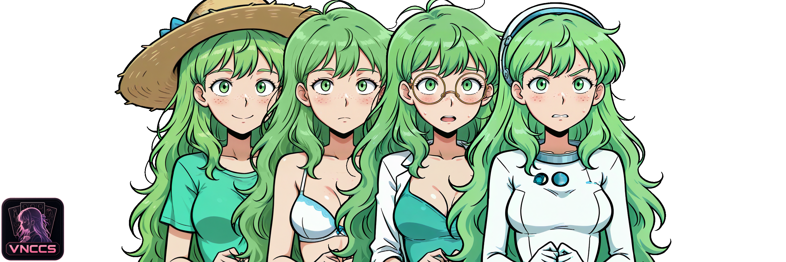

---
<table>
<tr>
<td width="50%" align="center">
<strong>Join The Community</strong> 
Share results, ask questions, and follow VNCCS updates.  
<a href="https://discord.com/invite/9Dacp4wvQw" target="_blank">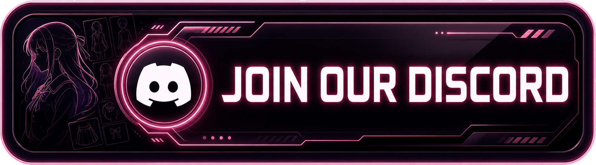</a>
</td>
<td width="50%" align="center">
<strong>Support VNCCS</strong> 
VNCCS is developed independently. Support helps keep the project moving.  
<a href="https://www.buymeacoffee.com/MIUProject" target="_blank">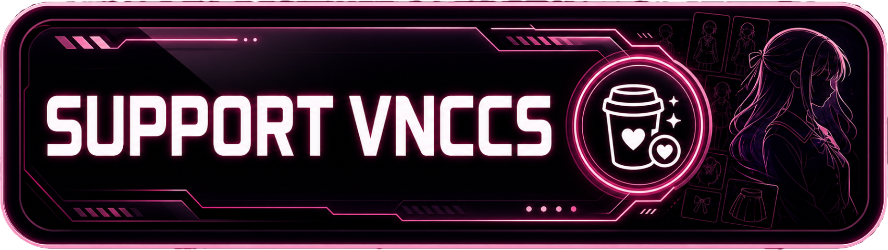</a>
</td>
</tr>
</table>

---

VNCCS is a complete pipeline for creating consistent characters, backgrounds, and CGs. You can create unique characters, organise their sprites, give them new poses, outfits, and expressions, and bring them together in scenes for your story.

## Description

Many people want to use neural networks to create graphics, but making a unique character that looks the same in every image is much harder than generating a single picture. With VNCCS, you can take that character from the first sprite all the way to a finished scene, one step at a time!

## Installation

For new ComfyUI users:
Use [VNCCS Easy Install](https://github.com/AHEKOT/VNCCS_Easy-Install). It installs ComfyUI with a preconfigured setup and working VNCCS nodes.

For experienced users:
Find `VNCCS - Visual Novel Character Creation Suite` in ComfyUI-Manager and install the latest version.

Manual install:

1. Extract the downloaded node into `ComfyUI/custom_nodes/vnccs/`, or run `git clone https://github.com/AHEKOT/ComfyUI_VNCCS.git vnccs` from `ComfyUI/custom_nodes/`.
2. Open `ComfyUI/custom_nodes/vnccs/` in your terminal.
3. Run `python -m pip install -r requirements.txt` with the Python interpreter that starts ComfyUI.

Launch ComfyUI and open one of the bundled workflows. If it reports missing nodes, open ComfyUI-Manager and choose **Install missing custom nodes**. Install or enable **VNCCS-Utils** for Pose Manager and CG Creator, then restart ComfyUI.

## VNCCS 3.4 Workflow

Hi! My name is V-chan, and I am going to show you how to use the new VNCCS!

We got a BIIIIIIG update, and now everything is completely new, so listen carefully!

## Step 1: Character Creator

Open the workflow:

`VNCCS_3.4_Step1_CharacterCreator.json`

Let's start from the very beginning. The first thing you need to do, besides opening the workflow, silly, is figure out the **VNCCS Control Center**.
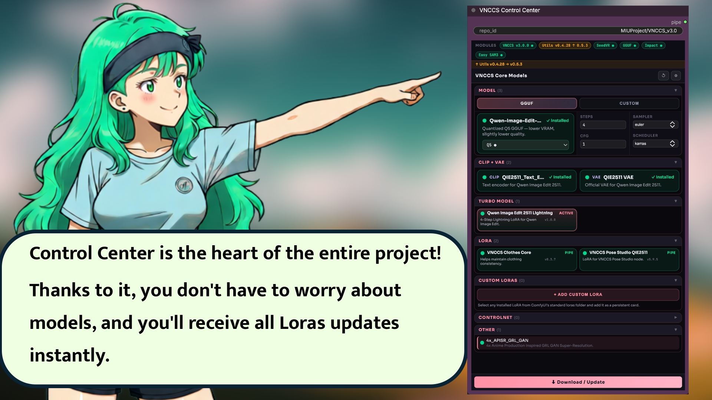

Inside it, you will find the models that turn your character into different poses and outfits. Choose the one that fits your computer and press **Download**.

- **Qwen Image 2.1** works from your character image to change poses and clothes. It can even give you a transparent background. Less green-screen trouble, yay!
- **Flux Klein9b** makes your sprites in just 4 steps. Want less waiting while trying poses and outfits? Give it a try!
- **MiniMax H3** is a video model, but here it helps you make character sprites! Try it for poses and clothes too, and see which result you like more.

Choose wisely, but in the end nobody is stopping you from trying them all and deciding later.

And then, at the very bottom of the widget, you can click the big **Download / Update** button and the magic will do everything by itself.

<table>
<tr>
<td width="50%" align="center" valign="top">
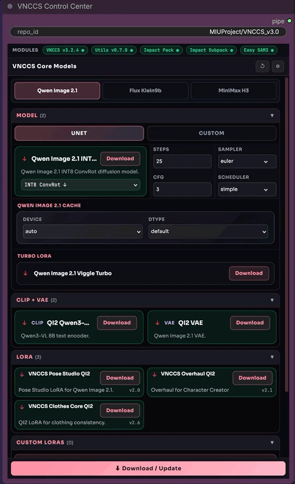
</td>
<td width="50%" valign="top">
<strong>Let the Control Center do the downloading!</strong> 
Choose the model components you need and press <strong>Download / Update</strong>. The model cards show download progress and installation status, so you can see when everything is ready for your character adventures.
</td>
</tr>
</table>

Next, go to **VNCCS Character Creator V2**.

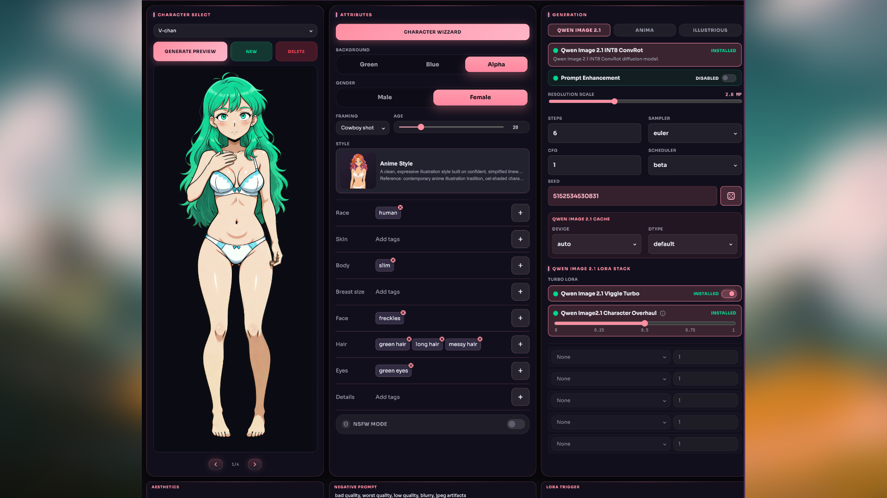
The most important thing here is to create a new character and choose the model for generation.

**Illustrious** may be considered old, but it makes excellent characters and has a huge selection of LoRAs for every style and occasion. Do not worry about quality, it will not disappoint you!

**Anima** is a new and cool model. It can do almost everything, but it will need a bit more resources, and there are not as many LoRAs for it yet.

**Qwen Image 2.1** is here too! It can create your character with a transparent background, and the **Turbo** option cuts down the number of generation steps. More time to try different characters, hehe!

I recommend trying all three and deciding for yourself.

Right now you do not have any characters yet, so press **NEW** and give him or her a name! The name is very important!!! Be creative and unique!

Done? Good job! Now you have two paths:

1. Enter character descriptions or use the pencil buttons to choose curated presets for race, skin tone, body type, face, hair, eyes, and details. Choose sex, age, and generation type. The **NSFW** switch controls whether the base character will have clothes or not :3
2. Press **CHARACTER WIZZARD**, describe the character you want, and after a little magic the system will set all the needed options by itself. Do not forget to check them!

The Character Wizzard, **Analyze Captions**, and Clothes Wizzard use ComfyUI's text generation. They can reuse your installed Qwen Image 2.1 text encoder. If they need the fallback model, the first run downloads `Qwen3.5-4B_int8_convrot.safetensors` into ComfyUI's text encoders. Give it a moment!

Race presets include natural-language descriptions of their distinctive anatomy, added automatically to generation prompts in Illustrious, Anima, and Qwen Image 2.1. Select multiple species for hybrids, or enter custom traits; the prompt gives explicit character traits priority over preset defaults. Existing character fields and custom text remain supported. Breast-size presets retain their original tags. Creator V2 uses `character_template/character_presets_v2.json`; the legacy catalog remains available to Character Cloner.

Click the **Style** card to open the style library. The bundled catalogs are `character_template/character_styles.json` and `character_template/anima_styles.json`, with 720×720 WebP previews in `character_template/style_previews/`. Style prompts describe artistic rendering. Background, pose, and framing have their own Creator settings.

<table>
<tr>
<td width="50%" align="center" valign="top">
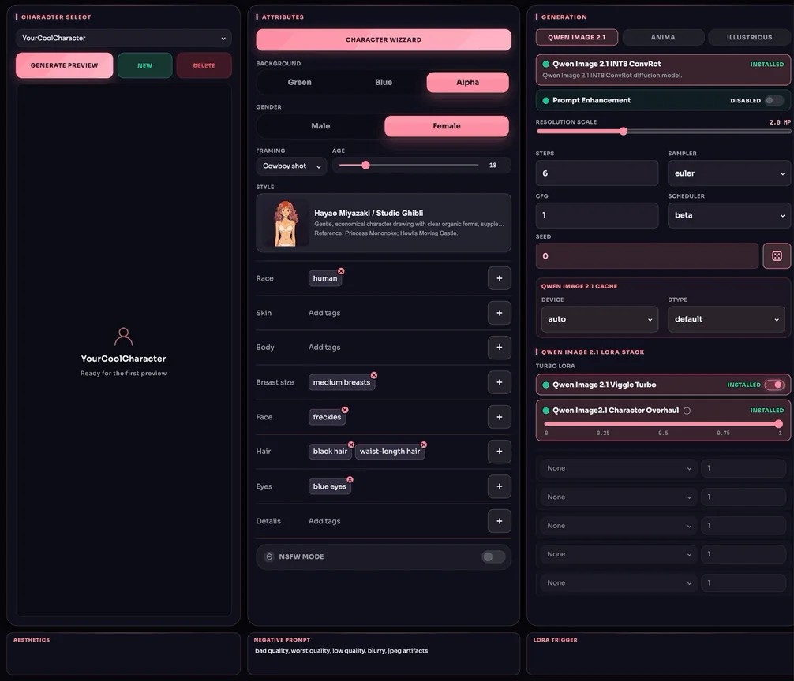
</td>
<td width="50%" valign="top">
<strong>Give your character a new drawing style!</strong> 
With <strong>Anima</strong> selected, open the style library, pick a style card, and press <strong>GENERATE PREVIEW</strong>. Watch the preview appear with the chosen style. Try a few looks before committing to a whole set of sprites!
</td>
</tr>
<tr>
<td width="50%" align="center" valign="top">
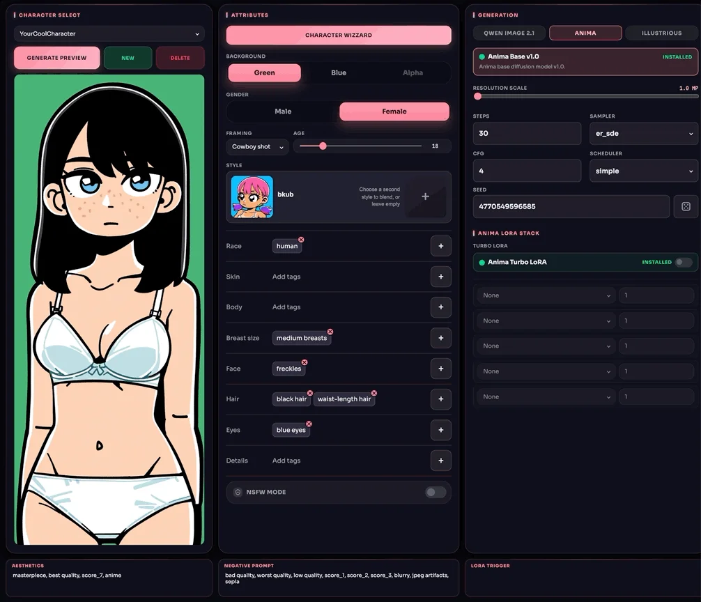
</td>
<td width="50%" valign="top">
<strong>One style is good. What about two?</strong> 
Click the <strong>+</strong> card beside the first style and choose another one from the library. Generate a new preview to see how Anima combines them. The animation starts with the first style's preview and ends with the mixed result. Time for a little experimenting, hehe!
</td>
</tr>
<tr>
<td width="50%" align="center" valign="top">
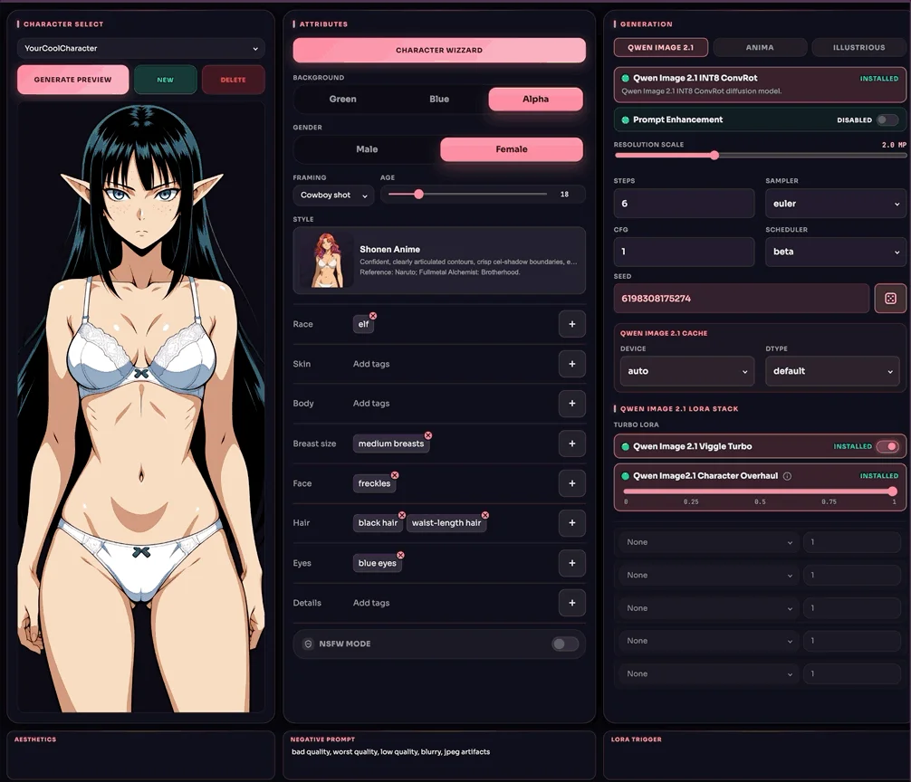
</td>
<td width="50%" valign="top">
<strong>Find your look with Qwen Image 2.1!</strong> 
Browse the style previews, search by name, or narrow the library with the category filter. Choose a style and press <strong>GENERATE PREVIEW</strong> with <strong>Qwen Image 2.1</strong> selected to try it on your character. So many looks to choose from!
</td>
</tr>
</table>

Choose **Custom style** or **New style** to enter a name, short description, reference, and style prompt. **Save style** adds it to **My styles**. **Generate preview** saves it and renders only that style using the current character tags and generation settings, a square portrait, and seed 0. **Resolution scale** controls the render quality, and saved previews are capped at 1024×1024. Transparent areas are composited onto the same dark gradient as the style cards. Previews are saved as opaque WebP at quality 90. User styles live in `character_template/character_styles.user.json`, with `user_*.webp` previews alongside the built-in images. Git and packaged updates exclude these user files.

The **×** button in the upper-right corner of a user style card opens a deletion confirmation. Confirming removes its library entry and preview, if present. Built-in styles cannot be deleted. Deleting the selected style switches the Creator to its default style.

You can save changes to an existing user style directly from its editor. If a user style changes during preview generation, the render returns HTTP 409 and preserves the previous preview. Generate the preview again for the updated style.

A new little feature is the **GENERATE PREVIEW** button. It lets you see what the character will look like without restarting the whole generation. So press it already, and if you like everything, move on. If you want to make changes, edit the descriptions and press it again!

<table>
<tr>
<td width="50%" align="center" valign="top">
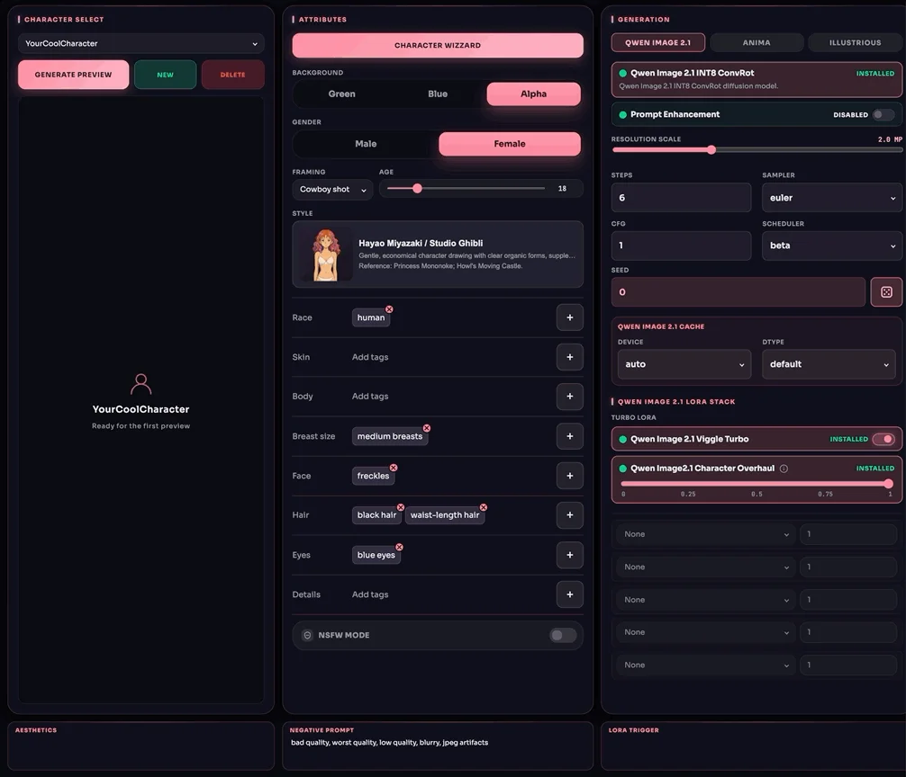
</td>
<td width="50%" valign="top">
<strong>Meet your character before the big generation!</strong> 
Press <strong>GENERATE PREVIEW</strong> and watch the character appear in the Creator's preview panel. Check the face, hair, body, and overall look. Something does not feel right? Change the character descriptions and try again until you are happy with the result!
</td>
</tr>
</table>

Creator and Cloner run with the character settings restored from the workflow and save them to the selected character's profile. Restoring a workflow keeps its draft fields; it does not require a profile version. Storage locks and atomic writes protect the save, while unreadable configurations and metadata belonging to another character are rejected.

## VNCCS Pose Manager

The next key node is **VNCCS Pose Manager**. It uses Pose Studio from my second project, **VNCCS-Utils**, so do not forget to install that too! The picture below shows the earlier Pose Studio interface.

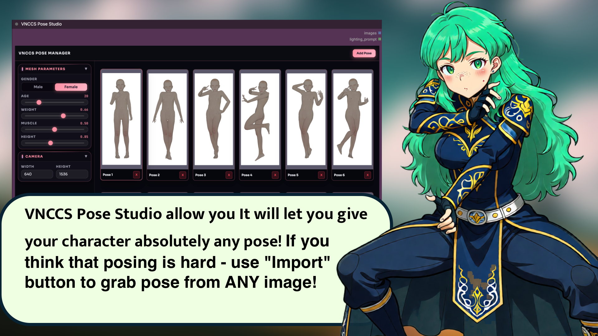

Here, the most important thing is to choose the poses you need and how many of them there should be. Open **Library** above the pose grid to load a whole set, or click **Library** on a pose card to change just that pose. You can pose the mannequin yourself or use **Capture pose from image** in the card library. Already have a favourite set? Save it to your library so you can use it again!

It is also very important that the body proportions of the mannequin fit your character. Try automatic proportion analysis, then check the age, height, and body type yourself. A little adjustment here can make a big difference later!

In **VNCCS Character Generator**, you do not really need to worry about the settings, but if you want, you can choose the upscaler model or even turn it off.
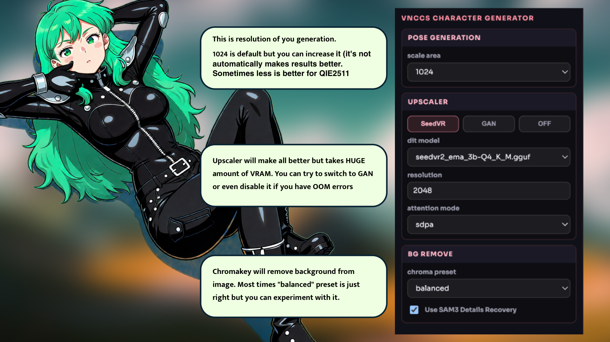

In **BG Remove**, you can choose a chroma key preset. **Balanced** is a very good preset, but if it is not enough for you, or if it is too much and starts damaging the character, choose a lighter one.

**SAM3 Details Recovery** makes background removal slower, but it lets you worry less about eye color and clothing elements that are the same color as the background. We will talk about clothes a little later.

Ready? Then press **Run**! Now just wait, and the magic will do everything for you!
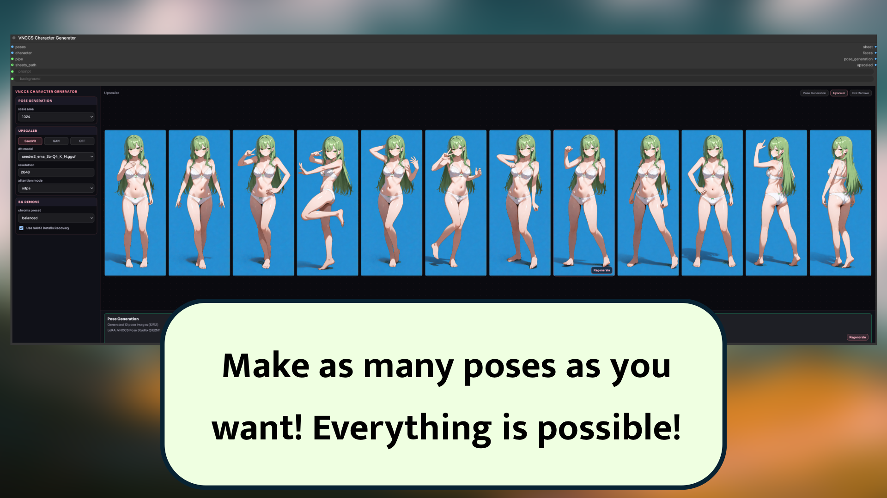

<table>
<tr>
<td width="50%" align="center" valign="top">
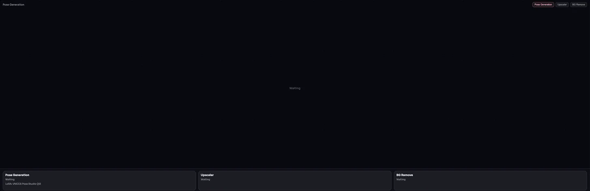
</td>
<td width="50%" valign="top">
<strong>From a pose guide to a character sprite!</strong> 
After you press <strong>Run</strong>, the generation preview shows the pose guides and the finished character sprite as it becomes ready. Check how the character follows the pose and whether the proportions look right. Your character is getting ready to move into the story!
</td>
</tr>
</table>

## Step 1.1: Character Cloner

Open the workflow:

`VNCCS_3.4_Step1_CharacterCloner.json`

The steps here will feel familiar. This time, you already have a character image to start from!

Did you generate the character with another model? Download it from the internet? Take a screenshot from your favorite anime? Draw it yourself, with your own hands? Good job!

Try to make sure the picture is good quality and that the character is full body, otherwise the model will invent everything that is not visible in the picture!

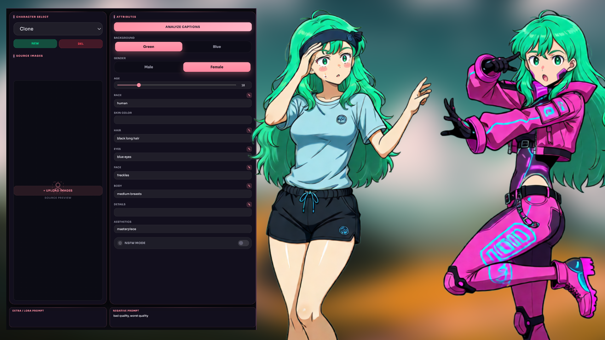

Now load it into **VNCCS Character Cloner**, write tags or press **Analyze Captions**, set up everything you need in **VNCCS Pose Manager**, and choose whether you need separate undressed sprites with the **NSFW** button. These sprites make it MUCH easier to dress your character later!

Also try to choose a background color that appears the least in the character. Look at the eyes and hair. If they are green, choose blue. Or the other way around.

Now press **Run** and look at the result!

## Step 2: Character Clothes

Open the workflow:

`VNCCS_3.4_Step2_CharacterClothes.json`

Now we move to the tastiest part! In this workflow, you will make clothes for the character. As many sets as you think you need.

Choose a character in **VNCCS Clothes Designer** and press **New**. Give the outfit set a name and get ready to create!

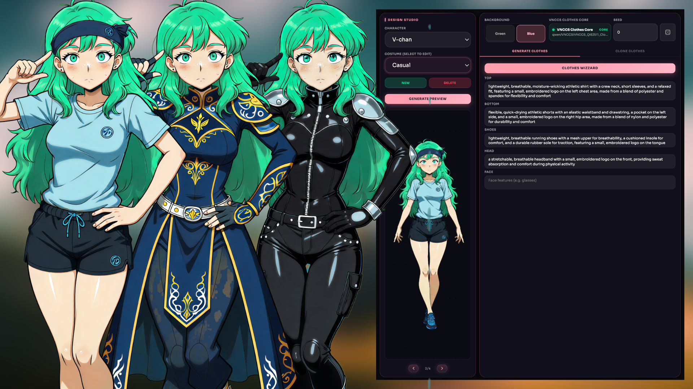

You have two options again:

1. Describe all clothing elements in the needed fields. You do not have to follow them exactly, but the **head** and **face** sections will help you later not to lose details during emotion generation, so do not slack off! If the character has glasses, write them in **face**. A hat goes in **head**. Easy!
2. Press **Clothes Wizzard** and simply describe the clothes you want!

You also have an option to clone any clothes from any picture! Open the **CLONE CLOTHES** tab and upload an image of clothes, or a character wearing clothes.

The **GENERATE PREVIEW** button will help you see what your character will look like before starting the big and heavy generation of all poses.

<table>
<tr>
<td width="50%" align="center" valign="top">
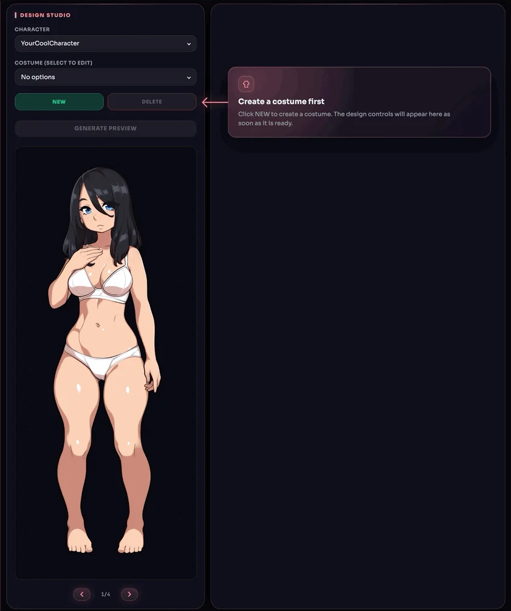
</td>
<td width="50%" valign="top">
<strong>A new outfit, from idea to preview!</strong> 
Choose your character, press <strong>New</strong>, and give the costume a name. Open <strong>Clothes Wizzard</strong>, describe the outfit, and press <strong>FILL FIELDS</strong>. Here, a short explorer-clothes idea becomes descriptions for the top, bottom, shoes, head, and face. Check those fields, then press <strong>GENERATE PREVIEW</strong> to see the character dressed for an adventure. A hat, boots, goggles... ready to go!
</td>
</tr>
</table>

And that is all! Check the poses in **VNCCS Pose Manager**, then press **Run**!

When you finish the first set, you can press **New** again and create as many outfits as you want!

If the costume was deleted while you were editing it, Clothes Designer keeps your local draft. Select an existing costume or create a new one before saving it.

API clients can post edits to `/vnccs/save_costume` with the character, costume, and `info`. Successful saves return the current `revision`. Editing a missing costume returns HTTP 404. To create a new costume, send `create_only: true`. An existing or reserved name returns HTTP 409.

Deleting and recreating a costume changes its version even when its name and fields are identical. Clothes Generator rejects the protected `Naked` and `Original` sets and requires an editable costume.

## Step 3: Character Emotions

Open the workflow:

`VNCCS_3.2_Step3_CharacterEmotions.json`

Here we will create emotions for the character! Up to this moment, all sprites had a calm facial expression. This will be our base.

In the **VNCCS Emotion Studio** widget, choose the character you are going to make emotions for. In **Selected costumes**, choose all costumes you want to work with.

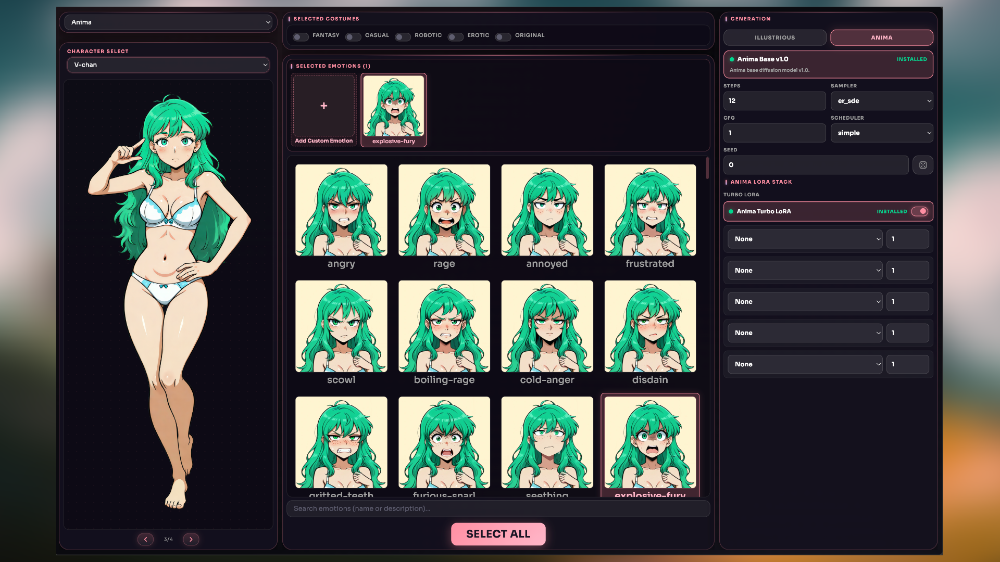

Now, in the huge list, click the emotions you need and add them to the selected ones. Also, if by some miracle you did not find what you need, you can add a **Custom** emotion and describe what you want yourself.

<table>
<tr>
<td width="50%" align="center" valign="top">
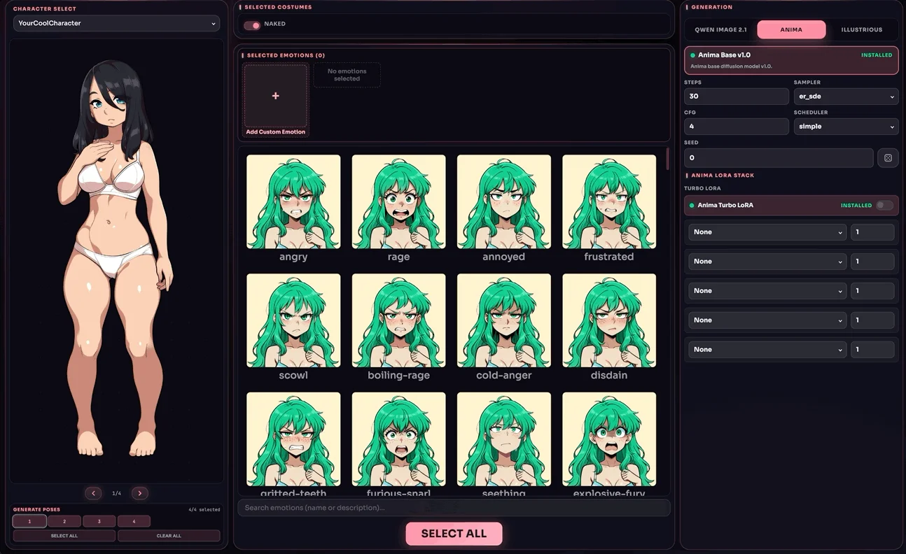
</td>
<td width="50%" valign="top">
<strong>Pick the expressions your story needs!</strong> 
Click emotion cards to add them to the selected list above the library. Use the search field to find a particular expression without scrolling through every card. The animation builds a small selection of different moods. A little pout, a happy smile, maybe something more mischievous?
</td>
</tr>
</table>

After that, you again need to decide which model will do the generation.

**Illustrious** is stable, but the variety of emotions depends very strongly on the exact character, style, and model. Not all emotions may come out equally well.

**Anima** makes very cool emotions, but it is still too young, so it can be unstable. It can change character details too much, so try it yourself and decide what you like better.

**Qwen Image 2.1** can make emotions too! It works on the face and puts it back into your sprite, keeping the rest of the image in place. Describe the expression you want and give it a try!

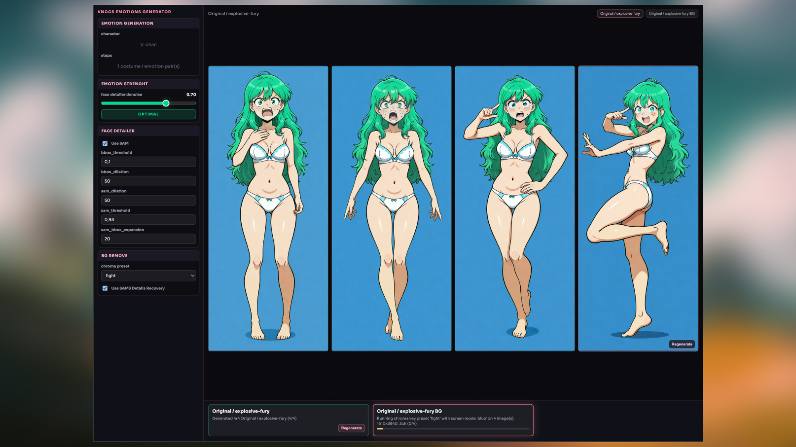

If you chose **Illustrious** or **Anima**, the most important setting in **VNCCS Emotions Generator** is **Face Detailer Denoise**. Start with the default value and remember that higher denoise changes more of the original image.

More denoise means a brighter emotion, but the character may stop looking like themselves.

Less denoise means a more accurate character, but the emotion may be weaker.

There is no ready-made recipe here. It all depends on the character and the selected model, so be creative and a tiny bit more patient.

For the first try, do not select all costumes and emotions at once. It will take a long time, and if the result does not satisfy you, it will be sad. Better find the optimal settings first, and then go all in!

Press **Run**, and may luck be with you!

<table>
<tr>
<td width="50%" align="center" valign="top">
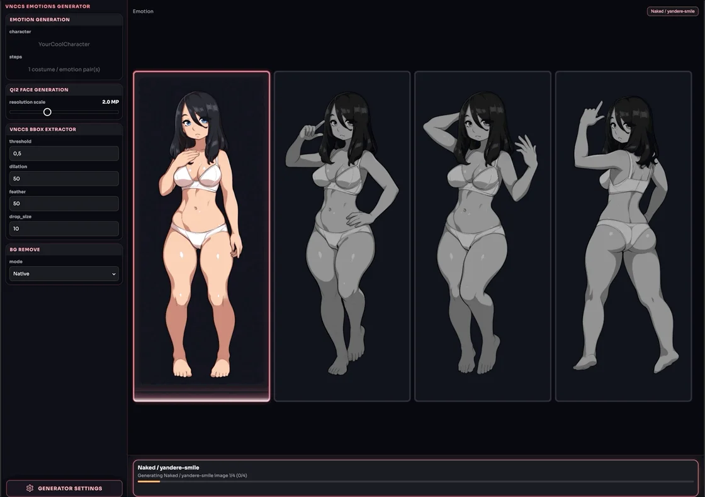
</td>
<td width="50%" valign="top">
<strong>Now let your character show some feelings!</strong> 
Here, <strong>Qwen Image 2.1</strong> applies the selected <strong>yandere-smile</strong> expression to the character's poses. The pose cards update as each sprite is generated, while the progress bar shows the batch status. Check the faces before moving on to a bigger batch!
</td>
</tr>
</table>

### Need a few more poses?

Open `VNCCS_3.4_AdditionalPoses.json`. In **VNCCS Additional Poses**, pick your character, costume, and emotion, then choose the sprite you want to use as a reference. Set up the new poses in **VNCCS Pose Manager** and press **Run**. The new sprites join the ones you already made for that costume and expression!

## Step 4: Background Creator

Open the workflow:

`VNCCS_3.4_Step4_BackgroundCreator.json`

Now your characters need somewhere to go! A little café, a rainy street, maybe a castle with a suspiciously large number of doors? In **VNCCS Background Creator**, press **New** and give the location a name.

You have two paths again:

1. Choose **Interior** or **Exterior** and pick a style. Describe the scene and what goes in the **Front**, **Back**, **Left**, and **Right**. Or open **Background wizard**, give it a short idea, and press **FILL FIELDS**. Check what it wrote, choose **Qwen Image 2.1** or **Moss**, set the aspect ratio you want, and press **Generate background**.
2. Already have the perfect picture? Press **Upload image** and use it as your source.

The Qwen model card can download the required files. If you choose **Moss**, install its model files locally first. The widget shows which files are missing.

Now look at **Variants**. **Morning**, **Evening**, and **Night** are there to get you started. Edit their time, weather, or additional details, or press **Add variant** and make your own. Try the same street in the rain and in the sunshine. It's still the same place, so your characters won't get lost!

Ready? Pick the model you want to use for the variants in **VNCCS Control Center** and press **Run**. **VNCCS Background Generator** upscales the original with SeedVR2 first, then generates the variants. Set **Upscaler** to **OFF** to skip the final upscale of the variants. Check them as they appear in the gallery. If just one needs another try, you can regenerate that one.

## Step 5: CG Creator

Open the workflow:

`VNCCS_3.4_Step5_CG_Creator.json`

This is where your characters finally step into the scene! In **VNCCS CG Creator**, choose a saved background and pick the original or one of its variants. CG Creator uses **3D Factory** from **VNCCS-Utils**, so make sure it's enabled.

Before you start, have the MoGe model and Qwen Image 2.1 files ready. Both scene builders start with MoGe and use Qwen Image 2.1 with **VNCCS Lucid Dreams QI2** to refine the camera views. You can get the LoRA from **VNCCS Control Center**.

Pick **WorldMirror** to build a scene from Gaussian splats, or **MoGe** for a textured mesh. Press **Generate model** and give it a moment to build the scene. Then drag to look around, middle-drag to pan, and scroll to move. Play with **FOV** until you like the framing, or press **Recenter** to go back to the starting view.

Want to bring your characters in? Press **Add Character**, then choose a character, costume, emotion, and sprite. Use **Pose**, **Move**, and **Rotate** to put the mannequin where you want it. You can adjust its size and lighting or give it a **Character prompt**. Add another character if the scene needs company. Each mannequin has its own colour so Qwen can tell which sprite belongs to whom!

If the new camera angle reveals a part of the scene you want to fill in, try **Expand Scene**. Compare the captured view with the refined one, press **Rebuild Scene**, and use **Save Scene** if you like the result.

Happy with the shot? Press **Generate CG** and enter a scene name. Qwen Image 2.1 uses the background, the camera view, and any character references you chose to render the final image. The finished image appears in the gallery. Select it and press **Run** to output it from the node. Look at that, your characters are in the story!

You will find your sprites in `ComfyUI/output/VNCCS/Characters/` and your backgrounds and CGs in `ComfyUI/output/VNCCS/Backgrounds/`, under the default ComfyUI output folder.

Be careful with them, and do not delete them by accident while cleaning your disk!

