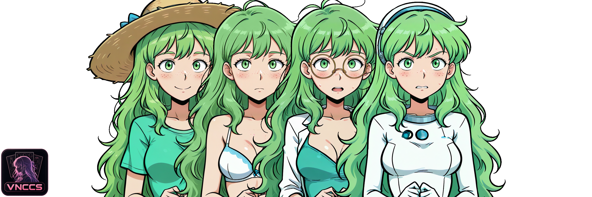

---
<table>
<tr>
<td width="50%" align="center">
<strong>Join The Community</strong><br>
Share results, ask questions, and follow VNCCS updates.<br><br>
<a href="https://discord.com/invite/9Dacp4wvQw" target="_blank">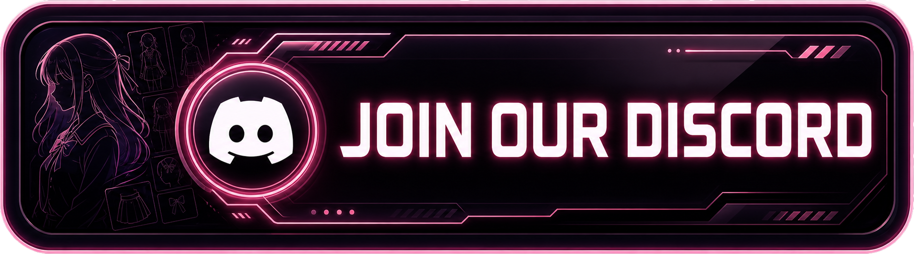</a>
</td>
<td width="50%" align="center">
<strong>Support VNCCS</strong><br>
VNCCS is developed independently. Support helps keep the project moving.<br><br>
<a href="https://www.buymeacoffee.com/MIUProject" target="_blank"></a>
</td>
</tr>
</table>

---

VNCCS is NOT just another workflow for creating consistent characters, it is a complete pipeline for creating sprites for any purpose. It allows you to create unique characters with a consistent appearance across all images, organise them, manage emotions, clothing, poses, and conduct a full cycle of work with characters.

## Description

Many people want to use neural networks to create graphics, but making a unique character that looks the same in every image is much harder than generating a single picture. With VNCCS, it's as simple as pressing a button (just 4 times).

## Installation

For new ComfyUI users: 
Use [VNCCS Easy Install](https://github.com/AHEKOT/VNCCS_Easy-Install). It installs ComfyUI with a preconfigured setup and working VNCCS nodes.

For experienced users:
Find `VNCCS - Visual Novel Character Creation Suite` in Custom Nodes Manager and click install latest version

Manual install:
1. Rename the downloaded node folder to `vnccs` and place it into `ComfyUI/custom_nodes/`. The resulting path must be `ComfyUI/custom_nodes/vnccs/`.
2. Alternatively, in the console: go to `ComfyUI/custom_nodes/` and run `git clone https://github.com/AHEKOT/ComfyUI_VNCCS.git vnccs`
3. `cd vnccs`
4. `pip install -r requirements.txt`
5. `python install.py`

Run both commands with the Python interpreter that starts ComfyUI. ComfyUI-Manager
runs `install.py` as its installation hook.

Post install steps:
Launch ComfyUI and open Comfy Manager
Click "Install missing custom nodes"

## VNCCS 3.2 Workflow

Hi! My name is V-chan, and I am going to show you how to use the new VNCCS!

We got a BIIIIIIG update, and now everything is completely new, so listen carefully!

## Step 1: Character Creator

Open the workflow:

`VNCCS_3.2_Step1_CharacterCreator.json`

Let's start from the very beginning. The first thing you need to do, besides opening the workflow, silly, is figure out the **VNCCS Control Center**.
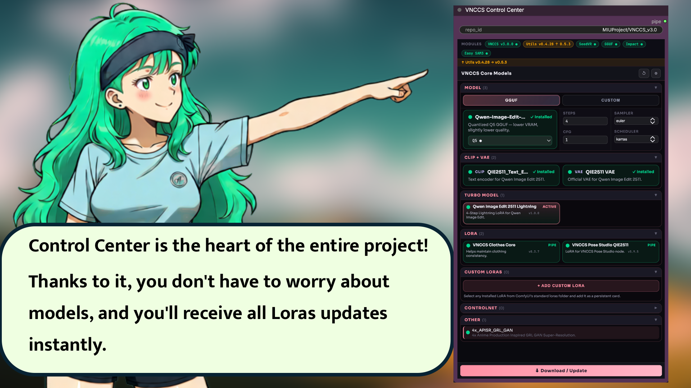

Inside it, you will find the models that turn your character into different poses and outfits. Choose the one that fits your computer and press **Download**.

- **Qwen Image 2.1** works from your character image to change poses and clothes. It can even give you a transparent background. Less green-screen trouble, yay!
- **Flux Klein9b** makes your sprites in just 4 steps. Want less waiting while trying poses and outfits? Give it a try!
- **MiniMax H3** is a video model, but here it helps you make character sprites! Try it for poses and clothes too, and see which result you like more.

Choose wisely, but in the end nobody is stopping you from trying them all and deciding later.

And then, at the very bottom of the widget, you can click the big **Download** button and the magic will do everything by itself.

<table>
<tr>
<td width="50%" align="center" valign="top">
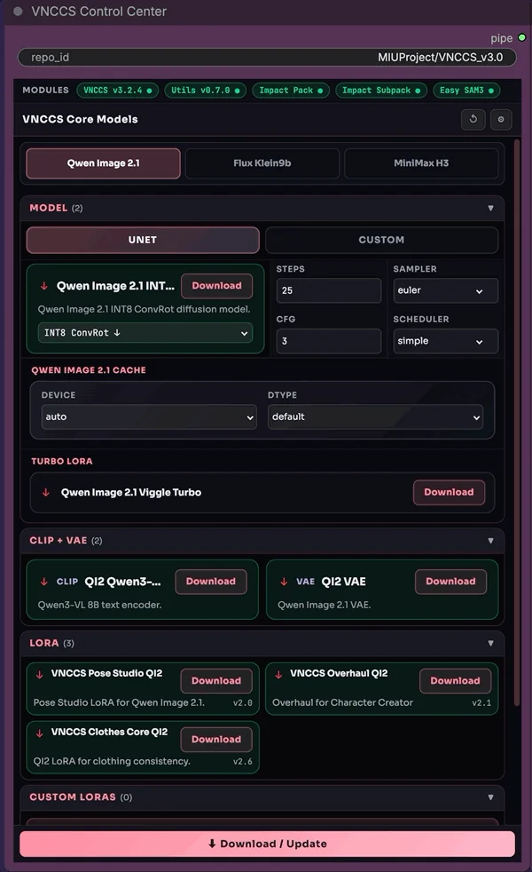
</td>
<td width="50%" valign="top">
<strong>Let the Control Center do the downloading!</strong><br>
Choose the model components you need and press <strong>Download / Update</strong>. The model cards show download progress and installation status, so you can see when everything is ready for your character adventures.
</td>
</tr>
</table>

Next, go to **VNCCS Character Creator V2**.

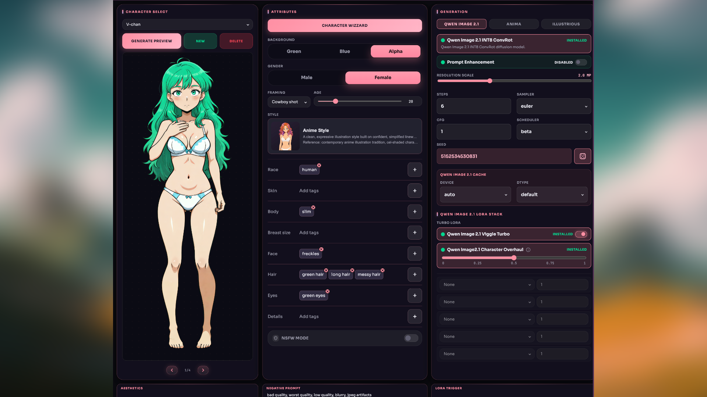
The most important thing here is to create a new character and choose the model for generation.

**Illustrious** may be considered old, but it makes excellent characters and has a huge selection of LoRAs for every style and occasion. Do not worry about quality, it will not disappoint you!

**Anima** is a new and cool model. It can do almost everything, but it will need a bit more resources, and there are not as many LoRAs for it yet.

**Qwen Image 2.1** is here too! It can create your character with a transparent background, and the **Turbo** option cuts down the number of generation steps. More time to try different characters, hehe!

I recommend trying all three and deciding for yourself.

Right now you do not have any characters yet, so press **NEW** and give him or her a name! The name is very important!!! Be creative and unique!

Done? Good job! Now you have two paths:

1. Enter character descriptions or use the pencil buttons to choose curated presets for race, skin tone, body type, face, hair, eyes, and details. Choose sex, age, and generation type. The **NSFW** switch controls whether the base character will have clothes or not :3
2. Press **CHARACTER WIZZARD**, describe the character you want, and after a little magic the system will set all the needed options by itself. Do not forget to check them!

Race presets include natural-language descriptions of their distinctive anatomy, added automatically to generation prompts in Illustrious, Anima, and Qwen Image 2.1. Select multiple species for hybrids, or enter custom traits; the prompt gives explicit character traits priority over preset defaults. Existing character fields and custom text remain supported. Breast-size presets retain their original tags. Creator V2 uses `character_template/character_presets_v2.json`; the legacy catalog remains available to Character Cloner.

Click the **Style** card to open the style library. Built-in styles and their 1024×1024 WebP previews ship with the node in `character_template/character_styles.json` and `character_template/style_previews/`. Style prompts describe artistic rendering; background, pose and framing remain separate Creator settings.

<table>
<tr>
<td width="50%" align="center" valign="top">
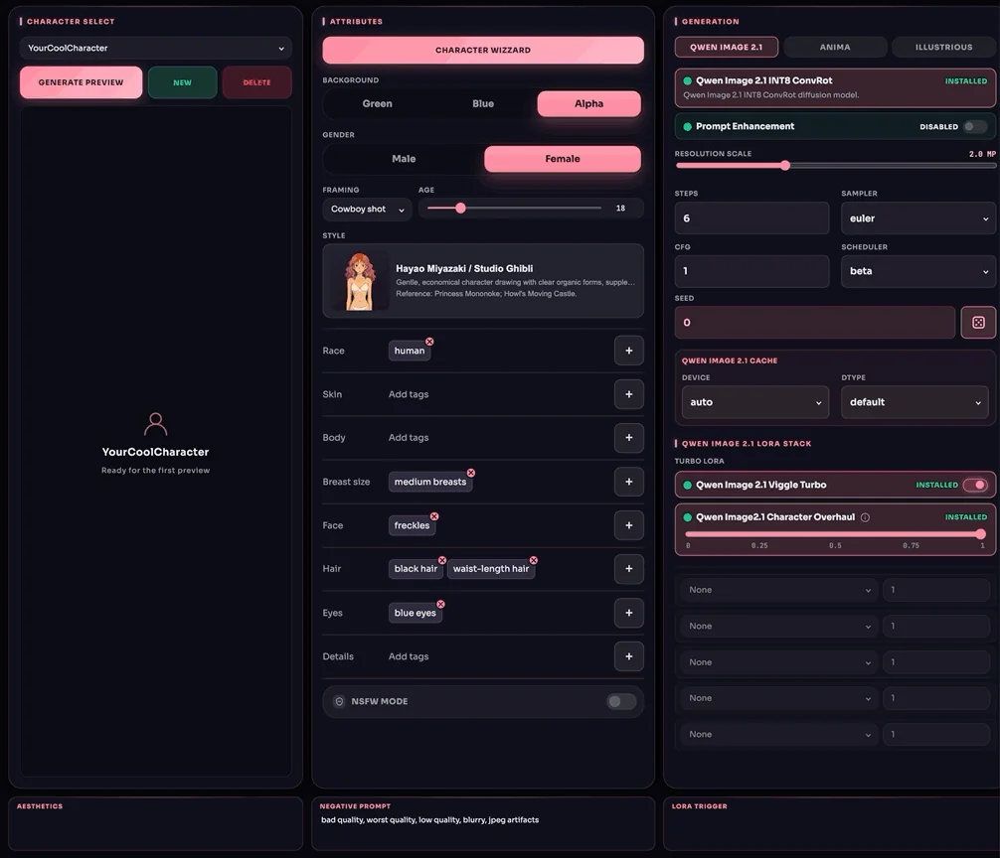
</td>
<td width="50%" valign="top">
<strong>Give your character a new drawing style!</strong><br>
With <strong>Anima</strong> selected, open the style library, pick a style card, and press <strong>GENERATE PREVIEW</strong>. Watch the preview appear with the chosen style. Try a few looks before committing to a whole set of sprites!
</td>
</tr>
<tr>
<td width="50%" align="center" valign="top">
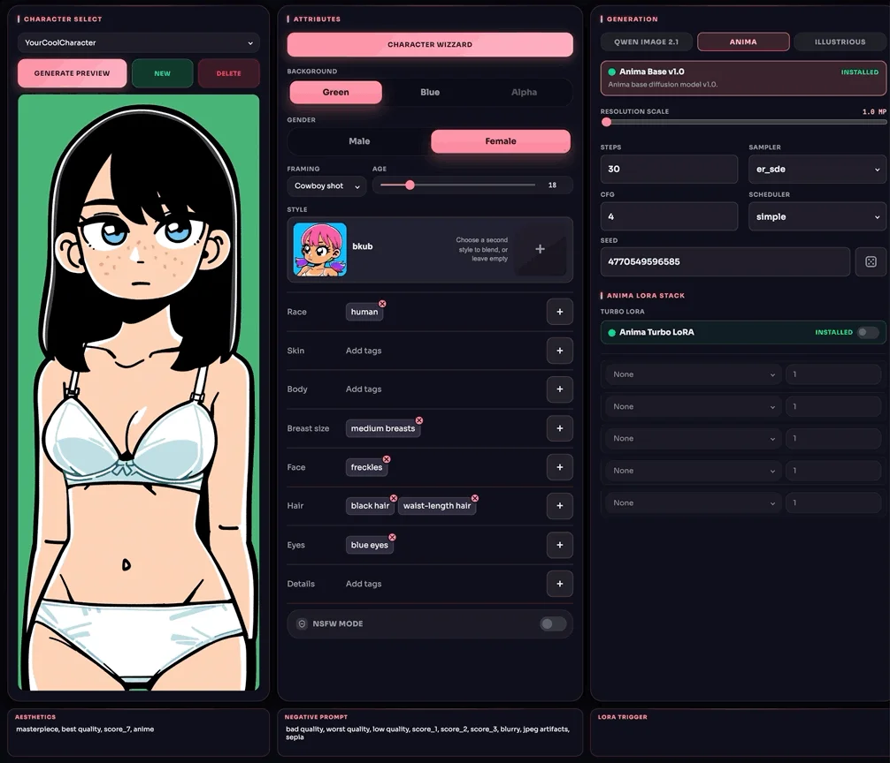
</td>
<td width="50%" valign="top">
<strong>One style is good. What about two?</strong><br>
Click the <strong>+</strong> card beside the first style and choose another one from the library. Generate a new preview to see how Anima combines them. The animation starts with the first style's preview and ends with the mixed result. Time for a little experimenting, hehe!
</td>
</tr>
<tr>
<td width="50%" align="center" valign="top">
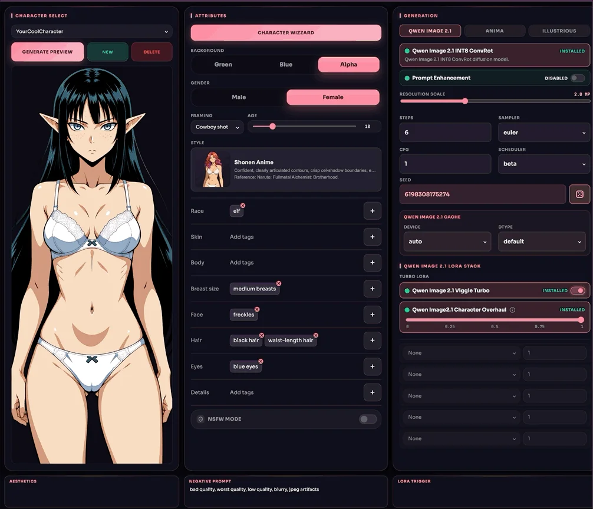
</td>
<td width="50%" valign="top">
<strong>Find your look with Qwen Image 2.1!</strong><br>
Browse the style previews, search by name, or narrow the library with the category filter. Choose a style and press <strong>GENERATE PREVIEW</strong> with <strong>Qwen Image 2.1</strong> selected to try it on your character. So many looks to choose from!
</td>
</tr>
</table>

Choose **Custom style** or **New style** to enter a name, short description, reference and style prompt. **Save style** adds it to **My styles**; **Generate preview** saves it and renders only that style using the current character tags and generation settings, a square portrait and seed 0. **Resolution scale** controls the render quality before the preview is resized to 1024×1024. Previews are composited onto the same dark gradient as the style cards and saved as opaque WebP at quality 90 directly inside the node, rather than ComfyUI's output directory. User styles live in `character_template/character_styles.user.json`, with `user_*.webp` previews alongside the built-in images; these user files are excluded from Git and packaged updates.

The **×** button in the upper-right corner of a user style card opens a deletion confirmation. Confirming removes its library entry and preview, if present. Built-in styles cannot be deleted. Deleting the selected style switches the Creator to its default style.

Style edits carry the `revision` returned by `/vnccs/character_styles`. A stale edit returns HTTP 409 and keeps the editor draft open. Keep any draft text before reloading the current style.

If a user style changes during preview generation, the render returns HTTP 409 and preserves the previous preview. Generate the preview again for the updated style.

A new little feature is the **GENERATE PREVIEW** button. It lets you see what the character will look like without restarting the whole generation. So press it already, and if you like everything, move on. If you want to make changes, edit the descriptions and press it again!

<table>
<tr>
<td width="50%" align="center" valign="top">
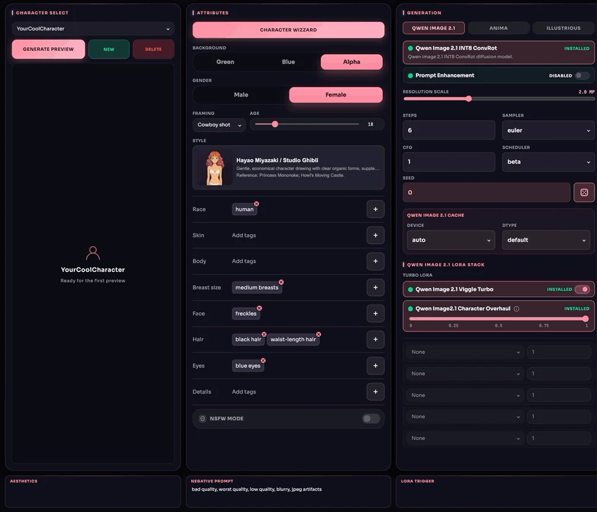
</td>
<td width="50%" valign="top">
<strong>Meet your character before the big generation!</strong><br>
Press <strong>GENERATE PREVIEW</strong> and watch the character appear in the Creator's preview panel. Check the face, hair, body, and overall look. Something does not feel right? Change the character descriptions and try again until you are happy with the result!
</td>
</tr>
</table>

Creator and Cloner run with the character settings restored from the workflow and save them to the selected character's profile. Restoring a workflow keeps its draft fields; it does not require a profile version. Storage locks and atomic writes protect the save, while unreadable configurations and metadata belonging to another character are rejected.

## VNCCS Pose Studio

The next key node is **VNCCS Pose Studio**.
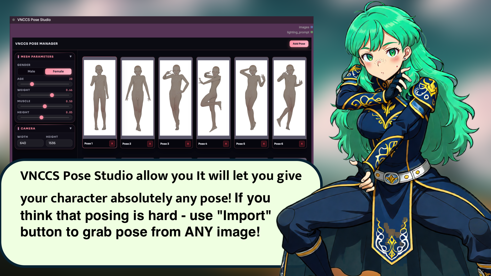

It is downloaded from my second project, **VNCCS-Utils**, so do not forget to install that too!

Here, the most important thing is to choose the poses you need and how many of them there should be. You can control the model however you want and make absolutely any poses. Also, using the **Import** button, you can load any picture with a character and get a pose just like the one in the picture!

It is also very important that the body proportions of the model fit your character. Age will be set automatically from the previous step, but nobody will stop you from setting it manually. Also choose height and body type, the result will be much better that way.

In **VNCCS Character Generator**, you do not really need to worry about the settings, but if you want, you can choose the upscaler model or even turn it off.
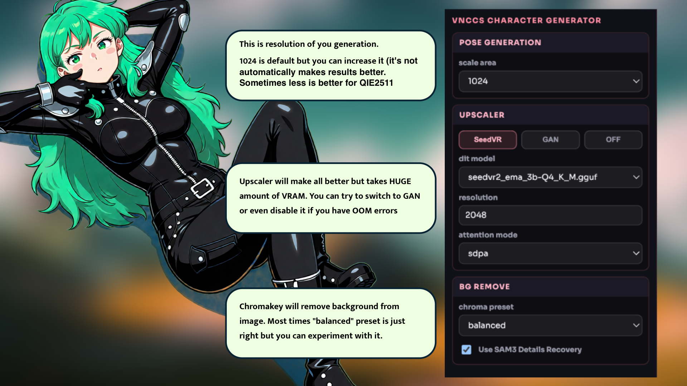

In **BG Remove**, you can choose a chroma key preset. **Balanced** is a very good preset, but if it is not enough for you, or if it is too much and starts damaging the character, choose a lighter one.

**SAM3 Details Recovery** makes background removal slower, but it lets you worry less about eye color and clothing elements that are the same color as the background. We will talk about clothes a little later.

Ready? Then press **Run**! Now just wait, and the magic will do everything for you!
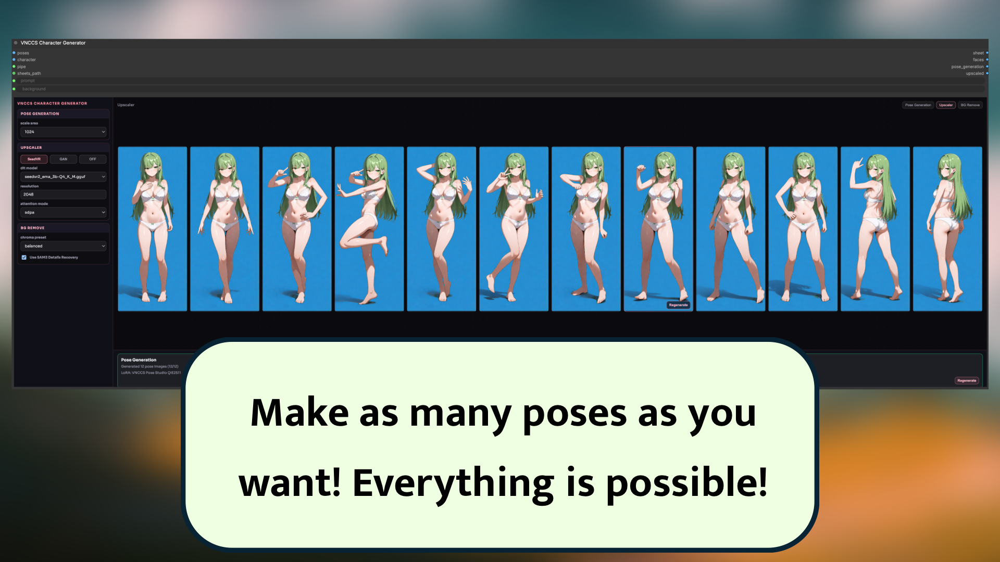

<table>
<tr>
<td width="50%" align="center" valign="top">
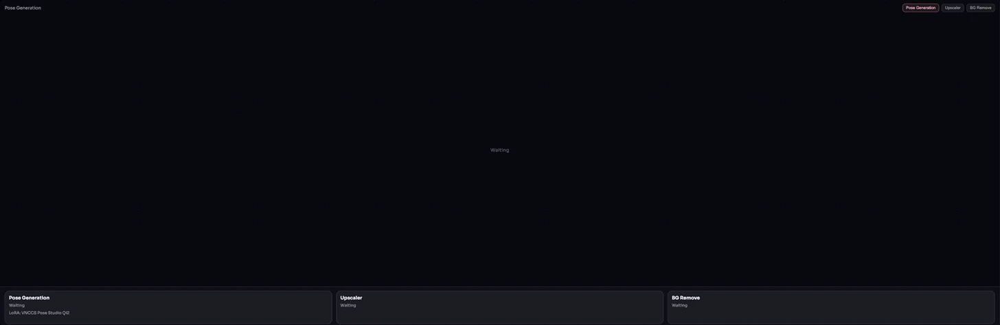
</td>
<td width="50%" valign="top">
<strong>From a pose guide to a character sprite!</strong><br>
After you press <strong>Run</strong>, the generation preview shows the pose guides and the finished character sprite as it becomes ready. Check how the character follows the pose and whether the proportions look right. Your character is getting ready to move into the story!
</td>
</tr>
</table>

## Step 1.1: Character Cloner

Open the workflow:

`VNCCS_3.2_Step1_CharacterCloner.json`

This workflow is basically a complete copy of Character Creator, but it is made for cloning existing character images.

Did you generate the character with another model? Download it from the internet? Take a screenshot from your favorite anime? Draw it yourself, with your own hands? Good job!

Try to make sure the picture is good quality and that the character is full body, otherwise the model will invent everything that is not visible in the picture!

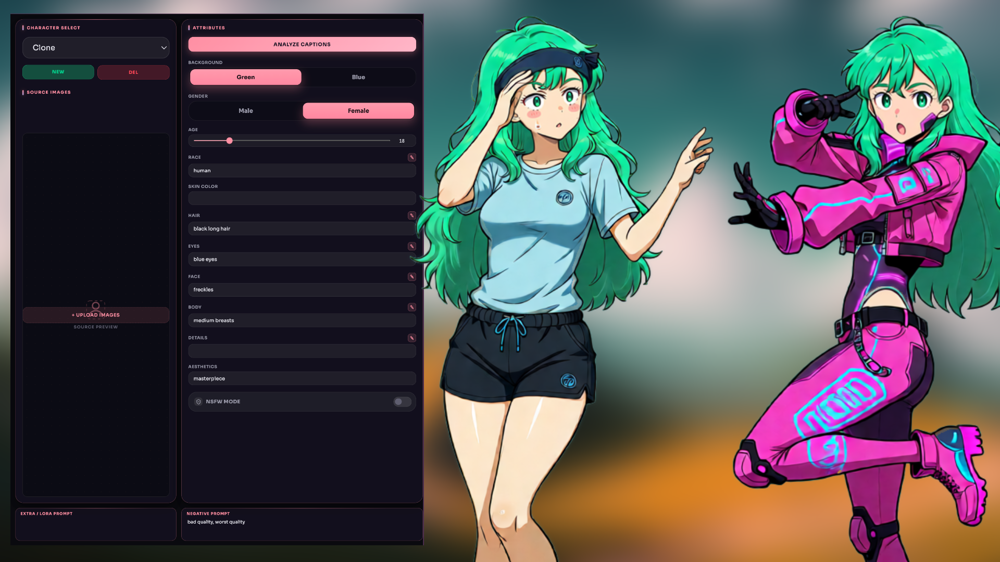

Now load it into **VNCCS Character Cloner**, write tags or press **ANALYZE CAPTIONS**, set up everything you need in **VNCCS Pose Studio**, and do not forget to choose whether you need separate undressed sprites with the **NSFW** button. They are not mandatory, but dressing these characters later will be MUCH easier!

Also try to choose a background color that appears the least in the character. Look at the eyes and hair. If they are green, choose blue. Or the other way around.

Now press **Run** and look at the result!

## Step 2: Character Clothes

Open the workflow:

`VNCCS_3.2_Step2_CharacterClothes.json`

Now we move to the tastiest part! In this workflow, you will make clothes for the character. As many sets as you think you need.

Choose a character in **VNCCS Clothes Designer** and press **New**. Give the outfit set a name and get ready to create!

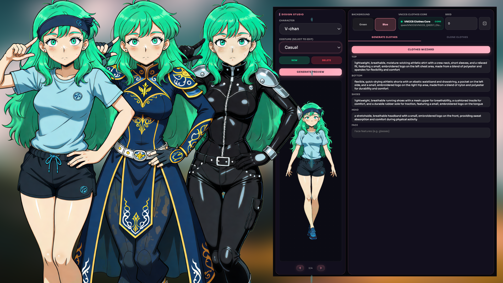

You have two options again:

1. Describe all clothing elements in the needed fields. You do not have to follow them exactly, but the **head** and **face** sections will help you later not to lose details during emotion generation, so do not slack off! If the character has glasses, write them in **face**. A hat goes in **head**. Easy!
2. Press **Clothes Wizzard** and simply describe the clothes you want!

You also have an option to clone any clothes from any picture! Open the **CLONE CLOTHES** tab and upload an image of clothes, or a character wearing clothes.

The **GENERATE PREVIEW** button will help you see what your character will look like before starting the big and heavy generation of all poses.

<table>
<tr>
<td width="50%" align="center" valign="top">
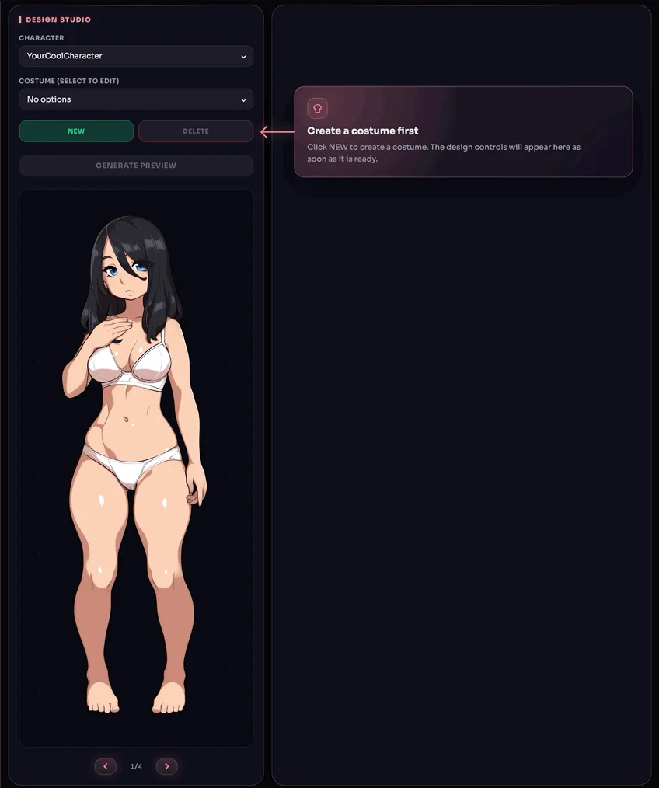
</td>
<td width="50%" valign="top">
<strong>A new outfit, from idea to preview!</strong><br>
Choose your character, press <strong>New</strong>, and give the costume a name. Open <strong>Clothes Wizzard</strong>, describe the outfit, and press <strong>FILL FIELDS</strong>. Here, a short explorer-clothes idea becomes descriptions for the top, bottom, shoes, head, and face. Check those fields, then press <strong>GENERATE PREVIEW</strong> to see the character dressed for an adventure. A hat, boots, goggles... ready to go!
</td>
</tr>
</table>

And that is all! Again, do not forget about **VNCCS Pose Studio**, and press **Run**!

When you finish the first set, you can press **New** again and create as many outfits as you want!

Costume saves detect changes made in another editor. A conflicting save preserves your local draft instead of replacing newer metadata or recreating a deleted costume. Reload the costume before retrying; retain any draft text you want to apply to the current version.

API clients must read `/vnccs/get_costume` and send its `ETag` header as the `revision` field when posting an edit to `/vnccs/save_costume`. Successful saves return the next `revision`; stale edits return HTTP 409, and edits without a revision return HTTP 428. Creating a new costume uses `create_only: true`.

Deleting and recreating a costume changes its version even when its name and fields are identical. Clothes Generator rejects the protected `Naked` and `Original` sets and requires an editable costume.

## Step 3: Character Emotions

Open the workflow:

`VNCCS_3.2_Step3_CharacterEmotions.json`

Here we will create emotions for the character! Up to this moment, all sprites had a calm facial expression. This will be our base.

In the **VNCCS Emotion Studio** widget, choose the character you are going to make emotions for. In **Selected costumes**, choose all costumes you want to work with.

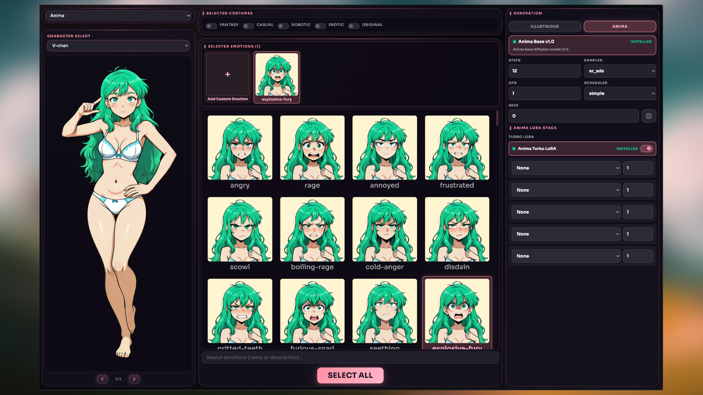

Now, in the huge list, click the emotions you need and add them to the selected ones. Also, if by some miracle you did not find what you need, you can add a **Custom** emotion and describe what you want yourself.

<table>
<tr>
<td width="50%" align="center" valign="top">
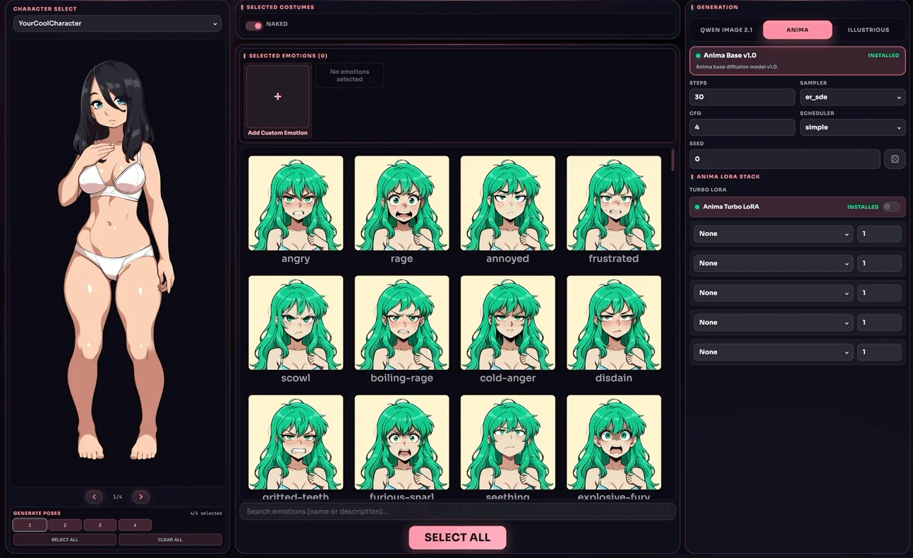
</td>
<td width="50%" valign="top">
<strong>Pick the expressions your story needs!</strong><br>
Click emotion cards to add them to the selected list above the library. Use the search field to find a particular expression without scrolling through every card. The animation builds a small selection of different moods. A little pout, a happy smile, maybe something more mischievous?
</td>
</tr>
</table>

After that, you again need to decide which model will do the generation.

**Illustrious** is stable, but the variety of emotions depends very strongly on the exact character, style, and model. Not all emotions may come out equally well.

**Anima** makes very cool emotions, but it is still too young, so it can be unstable. It can change character details too much, so try it yourself and decide what you like better.

**Qwen Image 2.1** can make emotions too! It works on the face and puts it back into your sprite, keeping the rest of the image in place. Describe the expression you want and give it a try!

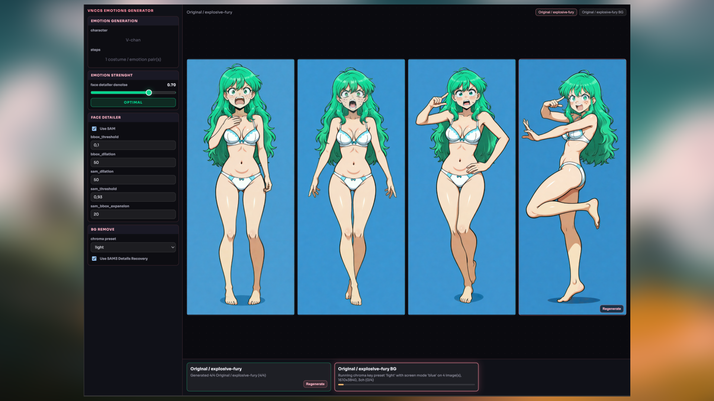


If you chose **Illustrious** or **Anima**, the most important setting in **VNCCS Emotions Generator** is **Face Detailer Denoise**. It will suggest optimal values by itself, but remember one basic idea: the higher the denoise, the more the original image changes.

More denoise means a brighter emotion, but the character may stop looking like themselves.

Less denoise means a more accurate character, but the emotion may be weaker.

There is no ready-made recipe here. It all depends on the character and the selected model, so be creative and a tiny bit more patient.

For the first try, do not select all costumes and emotions at once. It will take a long time, and if the result does not satisfy you, it will be sad. Better find the optimal settings first, and then go all in!

Press **Run**, and may luck be with you!

<table>
<tr>
<td width="50%" align="center" valign="top">
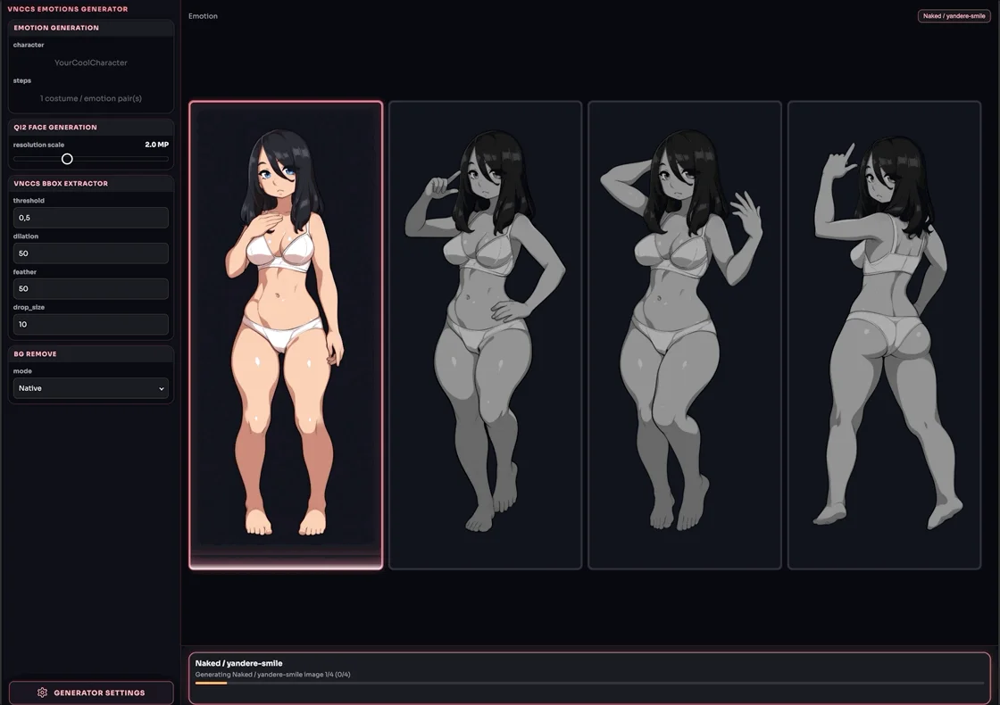
</td>
<td width="50%" valign="top">
<strong>Now let your character show some feelings!</strong><br>
Here, <strong>Qwen Image 2.1</strong> applies the selected <strong>yandere-smile</strong> expression to the character's poses. The pose cards update as each sprite is generated, while the progress bar shows the batch status. Check the faces before moving on to a bigger batch!
</td>
</tr>
</table>

At this point, the current VNCCS features end, but not for long! Planned features include animations, 3D environments and CG image creation inside them, character voice generation, and music track generation for your game or project.

You will find all your sprites inside ComfyUI in:`ComfyUI\output\VNCCS\Characters\` folder

Be careful with them, and do not delete them by accident while cleaning your disk!


## Background Creator

**VNCCS Background Creator** belongs to the main VNCCS package. It runs without
VNCCS-Utils, UniCanvas or 3D Factory. Update both VNCCS packages together when moving
from the earlier Utils implementation, then reload the ComfyUI frontend.

The **Background** stage uses the same Sakura controls as the other Creators:
select or create an environment, describe its attributes, run the background wizard,
upload an image inside the widget, or generate a background with Qwen Image 2.1 or
MOSS-Image. The model-type tabs retain separate generation settings in each
background's JSON.
The node has no IMAGE input. In the Background stage, RUN outputs the selected
background without advancing to Model: fresh generated previews are reused,
stale previews are regenerated, and uploaded images pass through unchanged.
Settings are saved in the selected background's JSON.
The **Model** stage reconstructs the complete environment with TripoSplat. Compose a
camera view, adjust FOV, use Recenter, then Save view to generate and retain a finished CG.
In the Model stage, workflow execution outputs the selected completed CG.

QI2 uses the existing ComfyUI Qwen Image 2.1 nodes and model folders. Defaults are
the INT8 ConvRot diffusion model and Qwen3-VL encoder, BF16 VAE, Euler/simple, 25 steps,
CFG 1, prompt enhancement and GPU INT8 cache. The optional Viggle Turbo adapter
uses six steps. Select models through the Creator card picker backed by Control
Center and the local model inventory. Five LoRA slots retain their positions.
The large preview supports variant navigation and click-to-enlarge. The full
prompt is editable; older scene descriptions remain preserved in its assembled
text. No character-specific LoRA is applied automatically.

Moss follows the supplied text-to-image workflow: MOSS-Image SFT INT8 ConvRot,
Qwen3.5 9B W4A8 GPTQ (`moss_image` encoder), Flux2 small VAE, 25 steps, CFG 2.5,
`er_sde`/`simple` and an empty Flux2 latent. It uses VNCCS's background prompt
enhancer and the same four-field prompt format. Qwen cache and Viggle acceleration
controls are hidden for Moss. Install these files in ComfyUI's registered model
folders:

- `diffusion_models/moss_image_sft_int8_convrot.safetensors`
- `text_encoders/qwen3.5_9b_w4a8_gptq.safetensors`
- `vae/flux2-vae_small.safetensors`

The middle panel contains Style, Interior/Exterior and Scene description. The base background always uses Day; time is configured in the variant cards below the preview. The generated prompt retains four ordered fields:

```text
Style: Anime, digital art, cel shaded
Time: Day
Interior/Exterior: Interior
Scene description: A complete description of the environment.
```

Prompt enhancement changes only the scene description. Legacy authored text and
attributes remain preserved when opening earlier scenes.
The VNCCS INFO logger prints the full enhancer system/input/output and the final
positive and negative inference prompts as readable blocks. Cached RUN outputs
show the saved inference prompt; uploaded images report that inference is skipped.
Background Generator logs each named variant prompt before encoding it.
The Generate background button and RUN share an input-based cache key stored
with the image's settings in the background JSON. Prompt, model type, weights,
LoRA, seed and sampling changes invalidate generated previews; inactive profiles,
camera and TripoSplat settings do not. Older generated previews without a key are
regenerated once, preserving legacy assets. Background Creator has one working
preview: generation and upload replace it without a history counter or arrows.
Legacy images and source files referenced by models or generated sets remain intact.

The empty **Morning**, **Evening**, and **Night** cards form one horizontal
strip with scroll arrows. Selecting a card opens an inline editor directly under
the strip inside the left column, with
Character Creator's tag fields and preset buttons for Time, Weather, and
Additional Details. Weather starts empty;
custom cards can be added. Each card has a delete control, including the defaults.
Deleting the last card leaves an empty list; Background Generator then upscales
and saves only Original. Card changes are saved in the selected background JSON;
deletion preserves existing images and generated sets. Day is already the base
preview; only the untouched legacy default Day is removed. Authored Day variants
remain editable. New backgrounds start with fresh default cards. Once Background Generator
saves a complete set, its matching card previews update automatically and return
after reopening. Previews match the source image, card ID and generation parameters.
The **Prompt** socket outputs a ComfyUI STRING **LIST**, with one JSON entry per
card containing its name, parameters, editing prompt and source identity.

**VNCCS Background Generator** takes `pipe`, `background`, and `prompt`. Connect
the Control Center pipe and the Background Creator's image and Prompt outputs.
It uses the same generator widget, settings, gallery, stage chain and Regenerate
controls as the character generators:

1. Always upscale the original with the configured native SeedVR settings.
2. Generate every variant from that same upscaled original in the selected QI2,
   Klein9b or MiniMax H3 editing model. No character or pose adapter is added.
3. Optionally upscale only the new variants; the original is never upscaled twice.

The gallery includes Original followed by every named card. The `backgrounds`
and `variations` outputs are IMAGE lists so different native sizes are retained.
Complete PNG sets are published to `VNCCS/scenes/NAME/background/sets/SET_ID/`,
with ordered filenames, all parameters and model/sampler settings recorded in
`NAME.json`. Every run creates an immutable set; failures preserve earlier sets
and the authored scene. Stage caches use the existing scoped generator cache
format inside the background folder. Regenerate reuses completed stages and can
replace one variant without regenerating the others.

Install TripoSplat weights in the configured ComfyUI model folders:

- `diffusion_models/triposplat_fp16.safetensors`
- `vae/triposplat_vae_decoder_fp16.safetensors`
- `vae/flux2-vae.safetensors`
- `clip_vision/dino_v3_vit_h.safetensors`

The widget reports missing weights. Existing files in registered model subfolders
are resolved by their unique filename. Background Creator preserves the complete
input and does not require a background-removal model, torchvision or a separate
native reconstruction package. It uses the existing PyTorch environment.

User data stays in `output/VNCCS/scenes/NAME/`: the named JSON document and validated
backup own immutable background variants, model snapshots, raw camera captures and
finished CG images. IDs, revisions, cameras and saved workflow state remain readable.
Removing an item from the selector archives it without deleting assets. Conflicting
or failed saves retain authored data; damaged JSON can open a validated backup read-only.
Earlier split libraries and Factory scaffold scenes are copied on access, with original
files retained. The old scene reader does not import Utils. Rollback must restore the
previous package pair; retain a copy of the output directory before changing versions.

TripoSplat's inference core is vendored under its original license and recorded upstream
commit in `data/triposplat`. The background-only build omits segmentation and replaces
image normalization with equivalent PyTorch/NumPy operations. The local Spark/Three.js
renderer and their licenses are in `web/vendor/spark`; no CDN is required.
